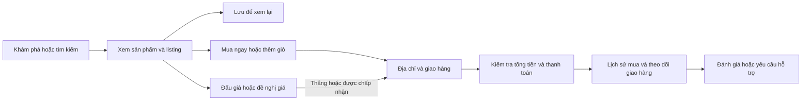

# Khảo sát eBay và nghiệp vụ Buyer

Ngày khảo sát: **10/11/2026**, múi giờ Asia/Saigon. Phạm vi: trải nghiệm người mua và thiết kế lại frontend trong `frontend/buyer-web`.

## 1. Phương pháp và mức độ xác thực

- **Quan sát trực tiếp:** mở [eBay](https://www.ebay.com/) bằng Brave trên Windows thông qua computer-use; đọc ảnh chụp cửa sổ và cây accessibility của trang chủ và trang kết quả tìm kiếm ở trạng thái chưa đăng nhập. Vị trí giao hàng trên trang hiển thị Vietnam.
- **Đối chiếu tài liệu:** đọc các trang eBay Help chính thức được dẫn ngay bên cạnh nghiệp vụ. Những mô tả này là thông tin từ tài liệu, không có nghĩa luồng đã được thao tác thành công trong phiên khảo sát.
- **Kiểm tra dự án:** đọc route React, API client, controller ASP.NET Core và hợp đồng trong `docs/04_API_Contract_Clone_eBay_Buyer.md`, `docs/06-product-details.md`, `docs/07-shipping-addresses.md`, `docs/08-product-list.md`.
- **Chưa kiểm chứng trực tiếp:** nội dung trang chi tiết sản phẩm, dữ liệu tài khoản đã đăng nhập, giỏ hàng, đặt giá, thanh toán, lịch sử đơn và yêu cầu hoàn trả. Thao tác mở sản phẩm tạo tab mới, nhưng công cụ computer-use dừng ở bước kiểm tra URL trước khi đọc được nội dung; do đó không coi đây là quan sát trang chi tiết. Không phát sinh giao dịch trên eBay.

Trang eBay thay đổi nội dung theo thời điểm, vị trí, tài khoản và thử nghiệm giao diện. Ảnh chụp của một phiên là cơ sở tái hiện bố cục; không đủ để khẳng định mọi trang hoặc mọi người dùng đều thấy giao diện giống nhau.

## 2. Giao diện thực tế đã quan sát

| Khu vực | Nội dung nhìn thấy | Ý nghĩa đối với Buyer |
|---|---|---|
| Thanh tiện ích | Hi! Sign in / register, Deals, Brand Outlet, Help & Contact | Vào tài khoản, khám phá ưu đãi, tìm hỗ trợ |
| Tiện ích bên phải | Địa điểm Vietnam, Sell, Watchlist, My eBay, Notifications, biểu tượng Cart | Điều chỉnh bối cảnh giao hàng, theo dõi mua sắm và vào giỏ hàng |
| Thanh tìm kiếm | Logo eBay, tìm kiếm, lựa chọn danh mục | Điểm bắt đầu khám phá sản phẩm xuyên suốt website |
| Điều hướng danh mục | Saved, Electronics, Motors, Fashion và các nhóm hàng khác | Mở lối vào theo sở thích hoặc ngành hàng |
| Banner đầu trang | “Get more with an eBay account” | Mời khách tạo tài khoản để sử dụng tính năng cá nhân |
| Khối sản phẩm công nghệ | “The future in your hands” và các danh mục công nghệ | Dẫn khách vào nhóm hàng cụ thể qua hình ảnh |
| Các khối khám phá | “Shopping made easy”, “Today’s Deals”, sản phẩm/xu hướng và footer | Tạo nhiều lối vào danh sách hàng ngoài thanh tìm kiếm |

Nguồn quan sát trực tiếp: [trang chủ eBay](https://www.ebay.com/). Các chữ trên banner là nội dung của phiên khảo sát, không phải quy tắc nghiệp vụ cố định.

Định hướng giao diện: nền trắng, nội dung rộng, thanh tiện ích nhỏ, tìm kiếm chiếm phần lớn hàng đầu, đường phân cách mảnh, nút tròn, ảnh sản phẩm lớn, khoảng cách thoáng và các khối chiến dịch có màu rõ ràng. Giữ tiếng Anh cho nhãn giao diện để bám sát mẫu; tài liệu phân tích dùng tiếng Việt.

### Trang kết quả tìm kiếm đã quan sát

Truy vấn mẫu: [tìm laptop trên eBay](https://www.ebay.com/sch/i.html?_nkw=laptop). Các kích thước dưới đây là ước lượng từ ảnh chụp, không phải thông số CSS lấy từ website.

| Khu vực | Ghi nhận trực tiếp |
|---|---|
| Cột bộ lọc trái | Rộng khoảng 220 px; category, nơi giao VNM, lựa chọn giao hàng và thuộc tính RAM/màn hình/CPU |
| Đầu danh sách | Số kết quả và chức năng lưu tìm kiếm |
| Điều khiển danh sách | Nhóm All/Auction/Buy It Now; Condition, Item location; Best Match và chuyển list/grid |
| Gợi ý lọc nhanh | Hàng bộ lọc phổ biến ở phía trên kết quả |
| Một hàng sản phẩm | Ảnh khoảng 256 px và nút hình tim; tiêu đề, tình trạng, giá VND in đậm, thông tin phản hồi người bán và giao hàng |

Đây là cơ sở bố cục cho trang catalog. Các bộ lọc và dữ liệu seller/shipping nhìn thấy trên eBay không tự trở thành khả năng của API dự án.

## 3. Hành trình nghiệp vụ Buyer

Sơ đồ mô tả phạm vi nghiệp vụ tham khảo, không phải cam kết rằng toàn bộ các bước đã có backend trong dự án.

### Khám phá, tìm kiếm và cân nhắc

Buyer tìm bằng từ khóa, sau đó thu hẹp theo tình trạng, thuộc tính sản phẩm, hình thức mua hoặc giao hàng. eBay có sắp xếp kết quả và Best Match; đây không phải thuật toán chỉ sắp theo ID hay giá. [How to use search](https://www.ebay.com/help/buying/search-tips/use-search?id=4006).

Watchlist lưu các listing đang cân nhắc; việc lưu không đồng nghĩa mua hàng hoặc giữ hàng. Người mua có thể thêm từ trang chi tiết hoặc kết quả tìm kiếm, rồi quản lý trong My eBay. [Your Watchlist](https://www.ebay.com/help/buying/finding-items-managing-purchases/watch-list?id=4046).

Saved searches lưu truy vấn và bộ lọc để tìm lại; eBay còn hỗ trợ thông báo khi có hàng phù hợp. Phải phân biệt lưu một listing với lưu điều kiện tìm kiếm. [Saved searches](https://www.ebay.com/help/buying/search-tips/saved-searches?id=4051).

### Quyết định mua

Listing cung cấp mô tả, ảnh và điều kiện mua/giao hàng. Buyer có thể mua theo giá cố định, tham gia đấu giá hoặc đề nghị giá nếu listing hỗ trợ. Một Product trong dự án có thể có nhiều Listing, nên giá và người bán phải thuộc listing được chọn. [How buying works](https://www.ebay.com/help/buying/buy-now/buy-now?id=4002).

Giỏ hàng chủ yếu dùng cho hàng có giá mua ngay. Thêm vào giỏ không giữ tồn kho; hàng vẫn có thể được người khác mua trước khi checkout. Vì vậy cần kiểm tra lại giá, khả dụng và số lượng khi đi tiếp. [Your shopping cart](https://ocsnext.ebay.com/help/buying/paying-items/shopping-cart?id=4360).

Đấu giá tự động nhận mức giá tối đa buyer sẵn sàng trả, rồi tăng giá theo bước trong giới hạn đó. Giá hiện tại khác với mức tối đa riêng tư của người tham gia. Giao diện không được coi nhãn Current bid là khả năng đặt giá đã triển khai. [Automatic bidding](https://www.ebay.com/help/buying/bidding/automatic-bidding?id=4014).

### Tài khoản, địa chỉ và sau mua

My eBay là nơi theo dõi hoạt động và các mục đã lưu. Đăng nhập, đăng ký, liên kết tài khoản và đăng xuất là các nghiệp vụ riêng; dự án hiện chỉ cung cấp đăng nhập bằng email/mật khẩu và đăng xuất ở client. [Signing in to your account](https://ocsnext.ebay.com/help/account/signing-account/signing-account?id=4189).

Địa chỉ giao hàng cần được chọn hoặc tạo trong checkout. Dự án đã có sổ địa chỉ, địa chỉ chính và kiểm tra địa chỉ thuộc buyer; phần này được mô tả chi tiết trong [07-shipping-addresses.md](07-shipping-addresses.md). Đổi địa chỉ tài khoản không sửa địa chỉ đã chụp lại trên đơn cũ.

Sau khi mua, buyer xem trạng thái giao trong Purchase history; theo dõi chi tiết phụ thuộc dịch vụ vận chuyển và dữ liệu tracking do người bán cung cấp. Không tự tạo mã vận đơn hoặc trạng thái giao hàng nếu API chưa có. [Tracking your item](https://www.ebay.com/help/buying/shipping-delivery/tracking-item?id=4027).

Luồng hoàn trả gồm tạo yêu cầu, người bán phản hồi, gửi trả khi được chấp nhận và theo dõi hoàn tiền. Trường hợp lỗi, hư hỏng hoặc không đúng mô tả khác với đổi ý; điều kiện xử lý phụ thuộc tình huống và chính sách liên quan. [Return an item for a refund](https://www.ebay.com/help/returns-refunds/returning-item/return-item-refund?id=4041).

## 4. Đối chiếu với backend hiện có

Bảng dưới đây dựa trên controller thực sự tồn tại, không suy ra từ danh sách endpoint đề xuất trong tài liệu cũ.

| Nghiệp vụ | Route frontend | API đang có | Phạm vi thực tế |
|---|---|---|---|
| Trang chủ và khám phá | `/` | Không yêu cầu API riêng | Nội dung điều hướng/chiến dịch là tầng trình bày |
| Danh sách sản phẩm | `/catalog` | `GET /api/products?page=&pageSize=` | Phân trang ở server; không có hợp đồng tìm kiếm, bộ lọc hay sort toàn catalog |
| Chi tiết sản phẩm | `/products/:productId` | `GET /api/products/{productId}` | Tên, mô tả, brand, condition, ảnh và nhiều listing/người bán |
| Đăng nhập | `/login` | `POST /api/auth/login` | Email/mật khẩu; token và user giữ trong bộ nhớ, tải lại trang cần đăng nhập lại |
| Giỏ hàng | `/cart` | `GET /api/cart`, `PATCH /api/cart/items/{id}`, `DELETE /api/cart/items/{id}` | Xem giỏ đã có, đổi số lượng, xóa mục; **chưa có API thêm giỏ** |
| Sổ địa chỉ | `/addresses` | GET danh sách/chi tiết/countries, POST, PATCH, PATCH default, DELETE dưới `/api/addresses` | CRUD và địa chỉ chính theo tài khoản |
| Chọn địa chỉ giao | `/checkout` | `GET /api/addresses/{id}` và API sổ địa chỉ | Chọn và xác thực địa chỉ; **chưa tạo đơn hoặc thanh toán** |
| Hồ sơ | `/profile` | `GET /api/me`, `PATCH /api/me` | Xem thông tin; sửa username/avatar trong phạm vi API |
| Lịch sử mua | `/orders` | Chưa có | Chưa có dữ liệu đơn tích hợp |
| Watchlist / Saved searches | Chức năng giao diện nếu được bổ sung | Chưa có | Lưu cục bộ phải được ghi rõ là cục bộ; không đồng bộ tài khoản eBay |
| Đấu giá / đề nghị giá | Chưa có luồng tích hợp | Chưa có | Chỉ đọc current bid từ listing hiện có |
| Checkout đầy đủ, payment, tracking, reviews, returns, messages | Chưa có luồng tích hợp | Chưa có | Cần backend và hợp đồng dữ liệu riêng |

Giá API hiện dùng **VND**. Giữ nguyên đơn vị đó khi hiển thị dữ liệu thật; đổi ký hiệu sang USD không phải chuyển đổi tiền tệ. Product summary chưa cung cấp phí ship, điểm seller, lịch sử giá hay số lượng bán; không trình bày các số liệu tự tạo như dữ liệu thật.

## 5. Quy tắc khi viết lại frontend

1. Giữ nguyên API, quyền truy cập và các xử lý loading, lỗi, rỗng, retry, hủy request cũ khi đổi trang.
2. Giữ phân trang trong URL; không báo bộ lọc cục bộ trên một trang là kết quả tìm kiếm toàn bộ catalog.
3. Phân biệt Product với Listing; giữ nhãn Current bid cho auction và trạng thái giá chưa có.
4. Điều hướng từ nút checkout của giỏ đến bước địa chỉ khi giỏ hợp lệ. Chọn địa chỉ không đồng nghĩa đơn đã được đặt.
5. Không giả thông báo thanh toán thành công, đặt giá thành công hoặc đặt hàng thành công khi không có API thực hiện.
6. Nếu bổ sung khu trưng bày hoặc dữ liệu mẫu cho giao diện, tách rõ với sản phẩm thật và không làm lỗi API biến thành dữ liệu mẫu một cách âm thầm.
7. Các phần cần tài khoản phải sử dụng phiên của ứng dụng clone; giao diện giống eBay không đồng nghĩa liên kết tài khoản với eBay thật.
8. Giữ trải nghiệm bàn phím, tên truy cập của nút biểu tượng, focus rõ, nhãn biểu mẫu và bố cục dùng được trên màn hình nhỏ.

### Ghi chú triển khai giao diện

- Ảnh công khai của trang chủ được lưu từ trình duyệt bằng Save As và sử dụng dưới dạng tài nguyên cục bộ để bám sát hình ảnh đã khảo sát. Việc lưu các ảnh này không cung cấp dữ liệu listing, giá hay tồn kho của eBay.
- Watchlist ở tầng frontend dùng lưu trữ trên thiết bị. Cần mô tả rõ phạm vi đó: không phải Watchlist đồng bộ tài khoản, và không có API watchlist phía server.
- Tìm kiếm/lọc phía client chỉ áp dụng cho trang sản phẩm đã tải vì API hiện chỉ hỗ trợ phân trang. Nhãn giao diện phải nêu rõ phạm vi; tổng sản phẩm của backend không được đổi thành tổng kết quả tìm kiếm toàn catalog.
- Checkout dừng ở chọn địa chỉ. Không có đặt đơn hay thanh toán thật và không được sinh trạng thái hoàn tất giả.
- Các ghi chú này xác định cách xử lý và giới hạn của bản viết lại; không thay thế kết quả build, kiểm tra tương tác hoặc xác nhận hoàn tất của người thực hiện.

## 6. Phần việc tiếp theo để hoàn chỉnh nghiệp vụ

- Hợp đồng tìm kiếm toàn catalog: từ khóa, category, condition, hình thức mua, giá, sort và tổng kết quả.
- API thêm listing vào giỏ với kiểm tra khả dụng/số lượng; xác định rõ nguồn tồn kho.
- Watchlist và saved searches theo tài khoản.
- Checkout preview, tính shipping/tax, kiểm tra tồn kho, tạo order và tích hợp payment có xử lý gọi lặp an toàn.
- Purchase history, tracking, review, return/refund và thông báo.
- Luồng auction riêng với giá tối đa được bảo vệ và kiểm soát cạnh tranh phía server.

Các mục này là khoảng trống chức năng được xác định trong khảo sát; việc thay đổi giao diện không tự hoàn thành chúng.

## Kiểm chứng bổ sung và kết quả triển khai

Sau khi chọn lại cửa sổ Brave, đã đọc được tab sản phẩm mới mở: HP EliteBook 840 G6, https://www.ebay.com/itm/237046456479. Accessibility xác nhận gallery, condition, quantity, Add to cart, Watchlist, shipping và returns. Không đăng nhập hay thực hiện giao dịch. Đây là cập nhật cho giới hạn quan sát trang chi tiết ghi ở phần đầu.

Frontend đã thay trang chủ, header/footer, catalog/detail, login, cart, profile và address/checkout; thêm Watchlist lưu theo thiết bị và các trang trợ giúp/trạng thái chưa hỗ trợ. Ảnh WebP và logo trong public/images/ebay được lấy từ bản lưu trang công khai bằng Brave; chỉ tái sử dụng tài nguyên ảnh, không đưa script của trang gốc vào ứng dụng.

Kiểm tra: npm run build và npm run lint thành công. Backend/database không thay đổi trong lần thiết kế lại này. Chưa kiểm thử end-to-end tài khoản thật; checkout vẫn chỉ chọn địa chỉ. Tìm kiếm/lọc/sắp xếp áp dụng trên trang catalog hiện tại, không phải toàn bộ dữ liệu. Đăng ký, thêm giỏ, mua ngay, bid, thanh toán, lịch sử đơn và thông báo cần API bổ sung.
